# Voting App: Ship It (DevOps Capstone 1)

A fork of [dockersamples/example-voting-app](https://github.com/dockersamples/example-voting-app) taken from code to automatic delivery: hardened container images, a CI pipeline that tests, scans, builds and pushes them, and a Helm chart with a tested rollback.

Author: <your name>

## Status

| Step | Status | Notes |
| --- | --- | --- |
| 1. Run it locally | Done | Docker Compose, vote on 8080, result on 8081 |
| 2. Containerize it safely | Done | Pinned digests, non root users, `.dockerignore`, patched dependencies |
| 3. Kubernetes cluster with Terraform | Blocked | The AWS account denies EC2 actions through a service control policy. A support case is open. See "Known issues" |
| 4. Automate with GitHub Actions | Done, deploy job pending | Test, Trivy scan, build and push work. The deploy job needs a cluster GitHub can reach |
| 5. Deploy and roll back with Helm | Done on a local kind cluster | Bad release and `helm rollback` demonstrated. AWS deployment pending step 3 |

## Architecture

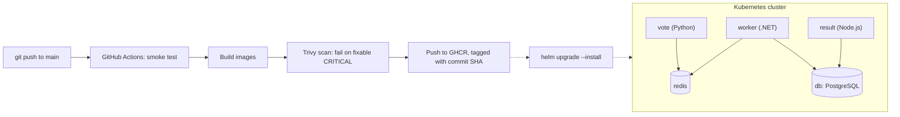

Dashed arrows are not automated yet. Today the Helm release is installed by hand against a local kind cluster.

How a vote travels: the vote app puts it in Redis, the worker moves it into PostgreSQL, and the result app reads the totals from PostgreSQL.

## Repository layout

```
.
├── vote/ result/ worker/     hardened Dockerfiles and .dockerignore files
├── helm/voting-app/          one chart, one values file
├── terraform/                cluster code (see Known issues)
├── .github/workflows/ci.yml  the pipeline
├── docs/
│   ├── scans/                Trivy reports
│   └── screenshots/          evidence for each step
├── docker-compose.yml
└── README.md
```

## Prerequisites

| Tool | Used for |
| --- | --- |
| Docker with Compose | Local runs and image builds |
| kubectl and Helm | Deploying and rolling back |
| kind | A local Kubernetes cluster for testing the chart |
| Trivy | Image scanning |
| Terraform and AWS CLI | Building the cloud cluster |

## 1. Run it locally

```
docker compose up -d --build
docker compose ps
```

Vote at http://localhost:8080 and watch the totals at http://localhost:8081. The app counts one vote per browser, so use a private window to vote again. Stop it with `docker compose down`.

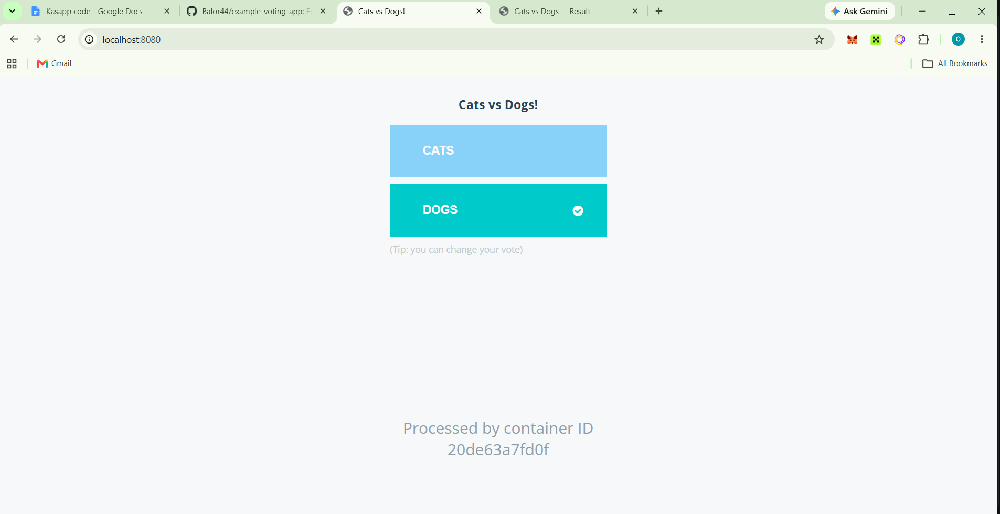

*The vote page after casting a vote.*

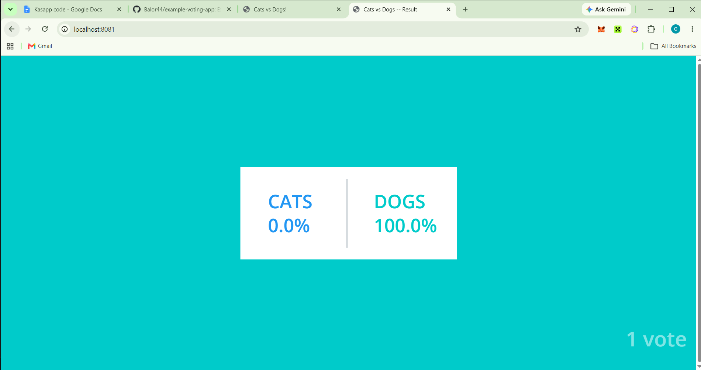

*The result page showing the totals.*

## 2. Container hardening

| Service | Base image | Changes |
| --- | --- | --- |
| vote | `python:3.11-slim` pinned by digest | Runs as user 1000. `pip`, `setuptools` and `wheel` upgraded in the build |
| result | `node:22-slim` pinned by digest | Runs as user 1000. OS packages upgraded, npm refreshed, lockfile updated to patched dependency versions |
| worker | .NET 8 SDK and runtime pinned by digest | Moved from end of life .NET 7. Runs as user 1000. Npgsql updated to 4.1.13 and System.Drawing.Common to 5.0.3. OS packages upgraded |

Every service also has a `.dockerignore`.

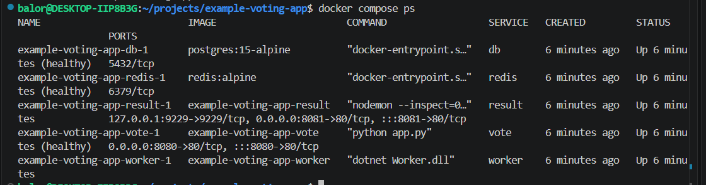

*The hardened containers running under Docker Compose.*

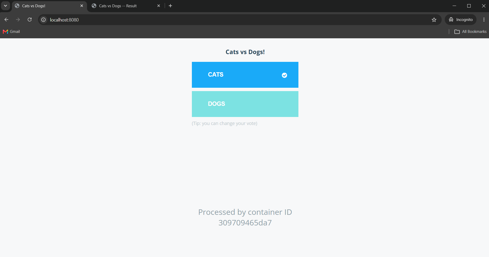

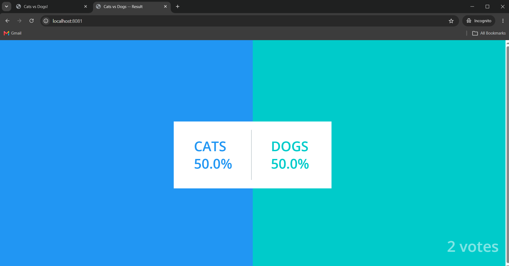

*Voting and results working on the hardened images.*

Why these choices:
- **Pinned digests** make builds repeatable, because a floating tag can change contents between builds.
- **A numeric non root user** limits what a compromised container can do, and Kubernetes can verify it with `runAsNonRoot`.
- **Patched dependencies** came from reading the Trivy reports and fixing what had a fix available.

### Scan baseline

| Image | HIGH | CRITICAL |
| --- | --- | --- |
| worker | 0 | 0 |
| result | 3 | 0 |
| vote | 4 | 0 |

The remaining HIGH findings sit in tooling bundled with the base images or in transitive packages (`setuptools`, `urllib3`, `brace-expansion`, `undici`). None is CRITICAL. They are tracked here as a known baseline, and the pipeline gates on fixable CRITICAL findings.

Reproduce a scan:

```
trivy image --severity HIGH,CRITICAL --ignore-unfixed --scanners vuln <image>
```

The full reports are in `docs/scans/`.

## 3. Cluster with Terraform

The plan is a single node k3s cluster on EC2 in the default VPC, built by the code in `terraform/`. Intended flow:

```
cd terraform
terraform init
terraform plan  -var="my_ip_cidr=$(curl -4 -s ifconfig.me)/32"
terraform apply -var="my_ip_cidr=$(curl -4 -s ifconfig.me)/32"
```

The rebuild proof will be recorded here once the account issue is solved: `terraform destroy`, then `terraform apply`, and a `Ready` node again without console work.

## 4. CI pipeline

Workflow: `.github/workflows/ci.yml`. It runs on every push to `main` and on pull requests.

1. **test**: starts the stack with Docker Compose and checks that the vote and result pages respond.
2. **build-scan-push**, for vote, result and worker in parallel:
   - builds the image,
   - scans it with Trivy and fails the build on any fixable CRITICAL finding,
   - on `main`, pushes it to GitHub Container Registry as `ghcr.io/<your-github-username>/<service>:<commit SHA>`.

Secrets: none are stored. The pipeline logs in to GHCR with GitHub's built in `GITHUB_TOKEN`. A deploy job will need a kubeconfig stored as a GitHub secret once a cluster is available.

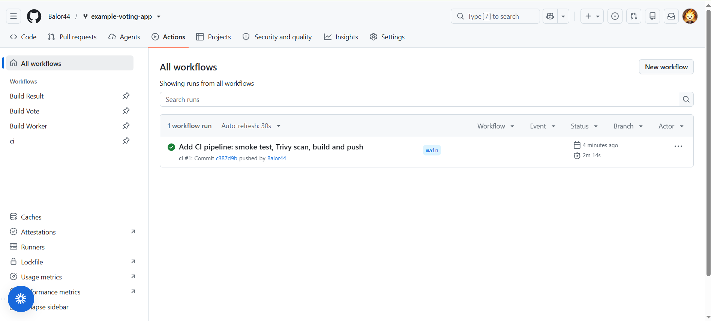

*A green run of the CI workflow in GitHub Actions.*

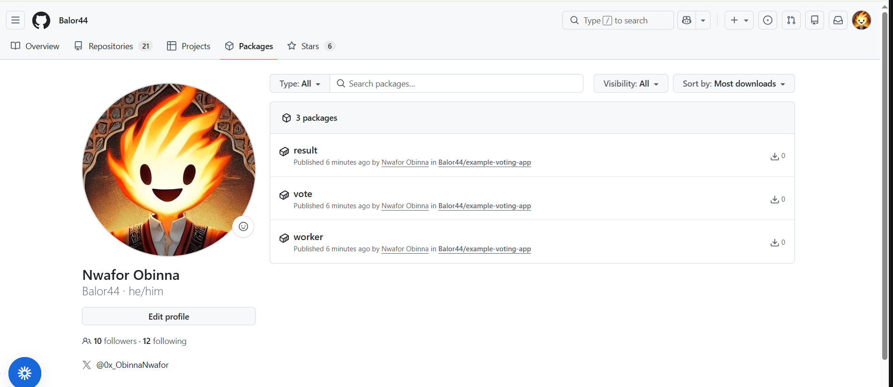

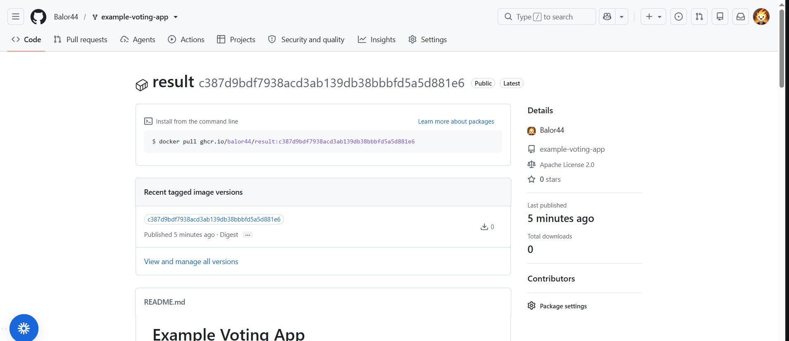

*The images pushed to GitHub Container Registry, tagged with the commit SHA.*

## 5. Helm chart and rollback

The chart is in `helm/voting-app/`, with all settings in one `values.yaml` (image repository, image tag, replica counts, node ports, Redis and Postgres images).

Install on a local kind cluster:

```
kind create cluster --name capstone
helm lint helm/voting-app
helm install voting-app helm/voting-app
kubectl get pods
```

Reach the apps through port forwards:

```
kubectl port-forward svc/vote 8080:80
kubectl port-forward svc/result 8081:80
```

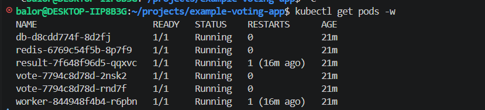

*All five pods running after `helm install`.*

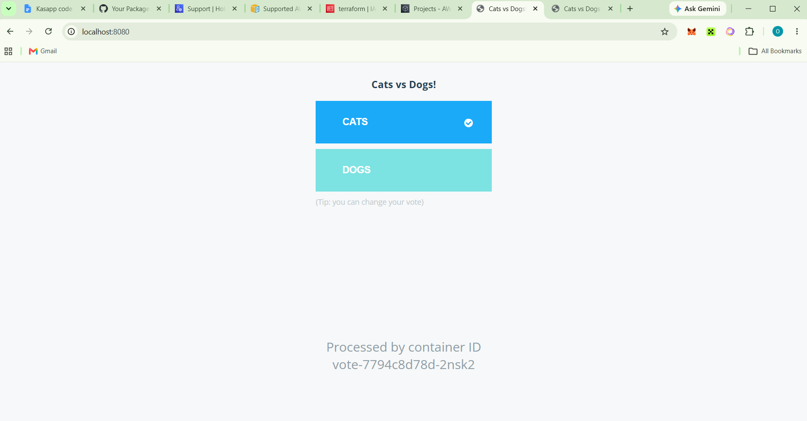

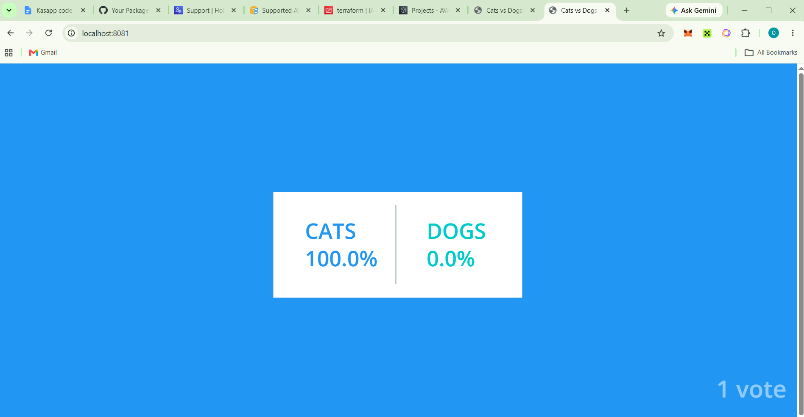

*The app working on the Kubernetes cluster.*

### Rollback demo

```
helm history voting-app
helm upgrade voting-app helm/voting-app --set image.tag=does-not-exist --wait --timeout 60s
kubectl get pods
helm history voting-app
helm rollback voting-app 1 --wait
helm history voting-app
```

What happens: the bad upgrade fails after 60 seconds because the new pods cannot pull their image. The old pods keep serving, because a pod that is not ready never receives traffic. `helm history` shows the failed revision, and `helm rollback` creates a new revision that reuses the earlier release.

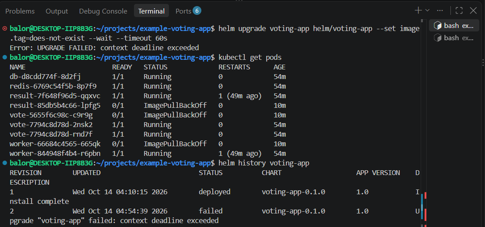

*The bad release fails, and the old pods keep serving.*

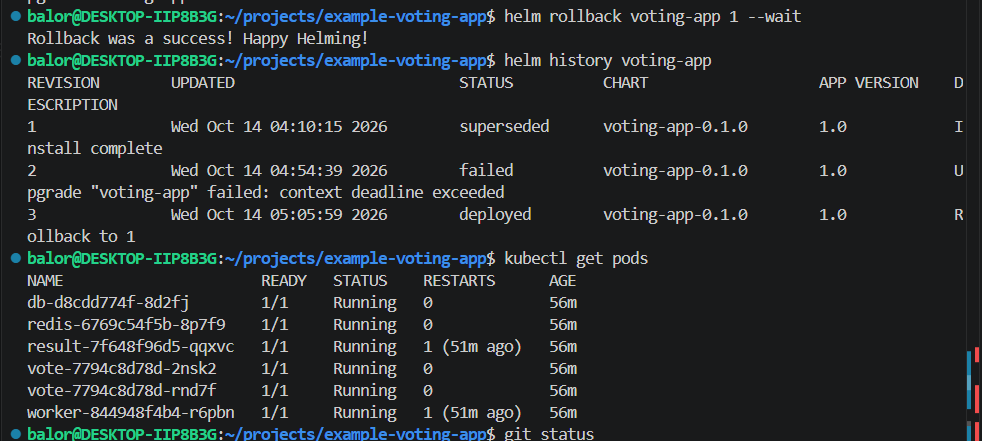

*`helm rollback` restores the working release.*

Notes on the chart:
- Readiness probes on vote, result, Redis and PostgreSQL.
- Containers run with `runAsNonRoot` and no privilege escalation. The vote and result pods set the `net.ipv4.ip_unprivileged_port_start` sysctl so a non root user can listen on port 80.
- The internal service names `redis` and `db` are fixed, because the apps look for those host names.

## Known issues and limitations

- **AWS access.** `terraform plan` fails with `UnauthorizedOperation` on `ec2:DescribeVpcs` and `ec2:DescribeImages`, in every region tried. The error reports an explicit deny from a service control policy, even though this account was created directly and shows no AWS Organization. A case has been opened with AWS Support. If it is not solved, the cluster step will move to another cloud with the same structure.
- **Deploy job.** The pipeline stops after pushing images. A job that runs `helm upgrade --install` needs a cluster reachable from GitHub's runners.
- **Database credentials.** The sample app has a built in demo login (`postgres` / `postgres`). It is not a real secret, and the app cannot read it from elsewhere without code changes.
- **Database storage.** PostgreSQL uses an `emptyDir` volume, so votes are lost if its pod restarts.
- **Image visibility.** The GHCR packages are public so a cluster can pull them without credentials.
- **Remaining scan findings.** See the baseline table above.
- **No secrets in Git.** `.gitignore` excludes Terraform state, `*.tfvars` and kubeconfig files.

## Tear down

```
helm uninstall voting-app
kind delete cluster --name capstone
# when the cloud cluster exists:
cd terraform && terraform destroy
```
